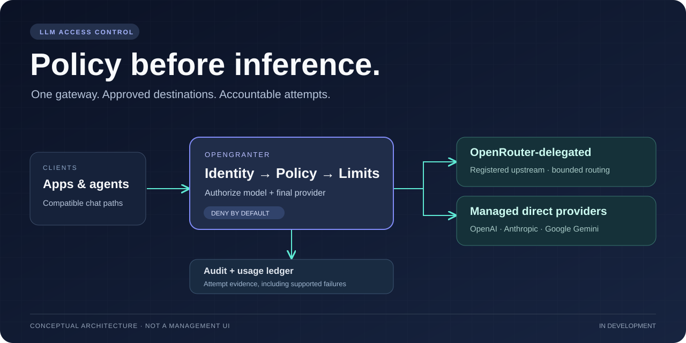
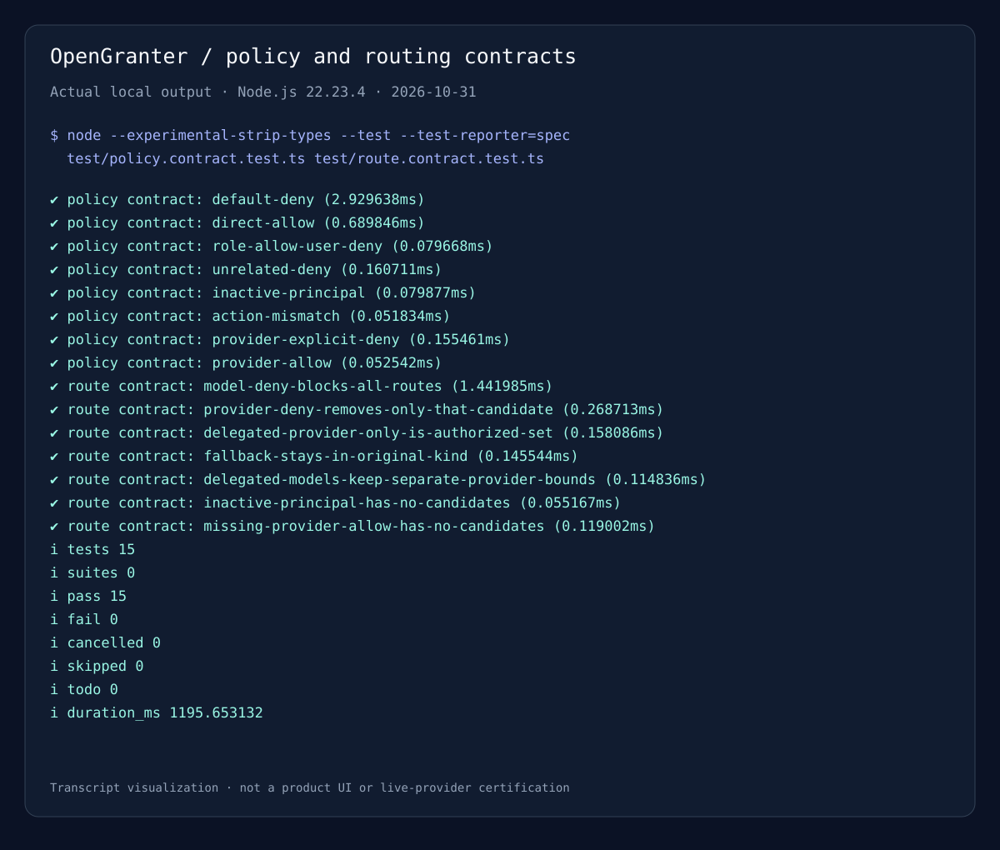

<div align="center">
  

  <h1>OpenGranter</h1>

  <p><strong>Control who can call which LLM — and account for every attempt.</strong></p>

  <a href="https://github.com/Theorvane/OpenGranter/actions/workflows/check.yml"></a>
  <a href="package.json"></a>
  <a href="docs/roadmap.md"></a>

  <p><a href="docs/guides/evaluate.md">Evaluate locally</a> · <a href="docs/README.md">Documentation</a> · <a href="docs/openrouter-compatibility.md">Compatibility</a> · <a href="CONTRIBUTING.md">Contribute</a></p>
</div>

OpenGranter is an LLM access-control gateway for a single organization. It combines user and role policies, approved model/provider routes, usage accounting, and audit records behind compatible chat boundaries. Use an **OpenRouter-delegated route** or a **managed route** to registered OpenAI, Anthropic, and Google Gemini providers without treating routing as an authorization bypass.

> **Development status:** this repository contains tested gateway modules, HTTP boundaries, PostgreSQL adapters, and an engineering harness — not a packaged, production-ready service. Deployment startup and remaining management and operational release gates are still in progress. The images below show architecture and local verification, not a shipped management dashboard. See the [roadmap](docs/roadmap.md) and [acceptance scenarios](docs/acceptance.md).

## Why OpenGranter?

- **Authorize the destination, not just the API key.** Evaluate both the model and final inference provider. Default Deny and explicit Deny precedence remain in effect across supported paths.
- **Keep routing inside policy.** Select only approved candidates; fallback stays within a route kind. Caller-supplied arbitrary upstream URLs are not a proxy feature.
- **Separate access from provider credentials.** Gateway identity and attachment controls are distinct from administrator-registered upstream secret references.
- **Make accounting limitations visible.** Preserve per-attempt usage and audit evidence; missing usage and possibly billed failures must not masquerade as zero cost. Estimated cost is not provider-billed cost.
- **Measure compatibility instead of assuming it.** Contract tests, pinned structural schema checks, and bounded external-client conformance record what has actually been verified.

## How a request flows

1. Authenticate the caller and resolve their current principal and attachments.
2. Resolve approved route candidates and evaluate the complete enforceable model/provider scope.
3. Check limits before invoking an allowed upstream.
4. Record attempt usage and the required audit outcome, including supported failure paths.

| Route | Upstream boundary | Authorization boundary |
| --- | --- | --- |
| **OpenRouter-delegated** | A registered OpenRouter upstream | Model and enforceable final-provider scope; constrained routing/fallback |
| **Managed** | Registered direct OpenAI, Anthropic, or Google Gemini adapter | Model and final provider; managed selection among allowed candidates |

The diagram is a conceptual overview, not a timing guarantee for every persistence operation. Read [routing](docs/routing.md) and [architecture](docs/architecture.md) for ordering and failure semantics.

## Capability map

“Implemented” here means repository modules and tests, **not** a deployable release or exhaustive provider certification.

| Area | Repository evidence | Boundary to keep in mind |
| --- | --- | --- |
| Identity and policy | Principal/role evaluation, attachment authentication, policy simulation | Internal IAM-style engine, not AWS IAM integration |
| Gateway and routing | Chat/model HTTP boundaries, Node socket bridge, managed/delegated coordination | No turnkey service startup; only registered, approved destinations |
| Providers and streams | OpenRouter, OpenAI, Anthropic, Gemini adapters; bounded text, tools, image, and streaming cases | Exact fields, combinations, and clients are bounded by the compatibility matrix |
| Persistence and accounting | PostgreSQL adapters and migrations, usage ledger, audit and export modules | Application-owned connection lifecycle, secrets, retention, and operational controls |
| External clients | Pinned OpenAI/OpenRouter SDK, AI SDK, and OpenCode conformance cases | Controlled fixtures are not live-provider or all-workflow certification |

Start with the [compatibility matrix](docs/openrouter-compatibility.md), [AI SDK evidence](docs/ai-sdk-conformance.md), and [OpenCode evidence](docs/opencode-conformance.md) before choosing a client workflow.

## Evaluate locally

Requires **Node.js 22.14 or later**, npm, and **Python 3.11 or later** for document checks. This is a source checkout, not an npm package installation.

```sh
git clone https://github.com/Theorvane/OpenGranter.git
cd OpenGranter
npm ci
npm run check
```

`npm run check` runs TypeScript checks, linting, tests, document/contract checks, and offline validation of reviewed OpenRouter structural pins. It does **not** start a gateway or call live inference providers. Without an explicit test database URL, real PostgreSQL integration tests skip; unit and embedded database tests still run.

For a smaller first look, run the policy and routing contracts:

```sh
node --experimental-strip-types --test --test-reporter=spec \
  test/policy.contract.test.ts test/route.contract.test.ts
```

### Actual local verification



*Actual local contract-test output rendered as a terminal-style visualization, not a product UI or live-provider session. See [asset provenance and reproduction](assets/README.md) and the [raw transcript](assets/contract-checks.txt). A focused passing run is not a production-readiness claim.*

Continue with the [evaluation guide](docs/guides/evaluate.md) for PostgreSQL checks, schema drift, and deployment responsibilities.

## Documentation

| I want to… | Start here |
| --- | --- |
| Understand the product and release gates | [Requirements](docs/PRD.md) · [Acceptance](docs/acceptance.md) · [Roadmap](docs/roadmap.md) |
| Evaluate the source checkout | [Local evaluation](docs/guides/evaluate.md) · [Engineering harness](docs/harness.md) |
| Integrate a compatible client | [OpenRouter compatibility and setup](docs/openrouter-compatibility.md) |
| Understand authorization and routing | [Routing contract](docs/routing.md) · [Architecture](docs/architecture.md) |
| Find detailed contracts and decisions | [Documentation index](docs/README.md) |
| Continue development as a contributor or agent | [Contributing](CONTRIBUTING.md) · [Agent handoff](docs/HANDOFF.md) · [Coding rules](docs/coding.md) |

## Contributing

Open an issue, write an English implementation plan, use an issue-numbered branch, and submit a pull request. Production-code changes follow red–green–refactor; documentation-only changes run applicable checks. Contributions require a human DCO sign-off and disclosure of material AI assistance. See [CONTRIBUTING.md](CONTRIBUTING.md).

Repository documentation is written in English. [CLAUDE.md](CLAUDE.md) links to [AGENTS.md](AGENTS.md). Planning interviews use the [grill-with-docs skill](skills/grill-with-docs/SKILL.md), with agreed terminology in [CONTEXT.md](CONTEXT.md); upstream skill licensing is preserved in [skills/LICENSE](skills/LICENSE).

### Service process adapter

For an explicit deployment-owned bootstrap, validated listener settings and bounded signal shutdown, see [running the gateway service](docs/guides/service.md). This is not a turnkey deployment or a built-in quota/secret-manager implementation.
